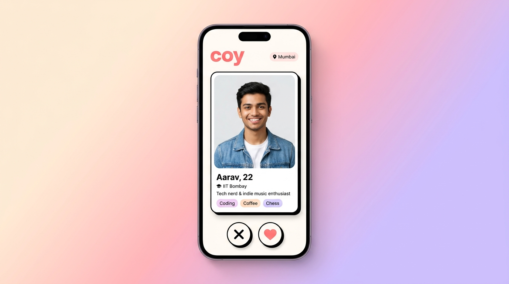

# Coy — Discover Tab Prototype

<p align="center">
  
</p>

A mobile-first swipe discovery feature built alongside Coy's existing experience using **Next.js (App Router)**, **Tailwind CSS**, **Framer Motion**, and **SQLite (`better-sqlite3`)**.

## Features
- **Coy-Matched UI:** Clean light-mode, pastel-accented, neo-brutalist interface matching Coy's brand identity.
- **Tab Navigation:** Includes a blank **Home** placeholder tab, the interactive **Discover** swipe deck, and a **Matches** list view.
- **Swipe Experience:** Smooth touch/mouse drag gestures on mobile and dedicated **Pass** / **Like** buttons on desktop, with clear visual stamps and an empty state once all profiles are reviewed.
- **Privacy-First Matching:** Pre-seeded likes (`has_liked_me`) remain strictly server-side in SQLite and are never exposed in `/api/feed`. Only mutual likes trigger an **"It's a match!"** modal and appear in `/api/matches`.
- **SQLite Persistence:** Swipes and mutual matches persist across page reloads in a local SQLite database (`coy.db`), automatically seeded with 32 profiles on first startup.

## Project Structure

```text
coy-discover/
├── src/
│   ├── app/
│   │   ├── api/
│   │   │   ├── feed/route.ts      # GET unswiped profiles (strips has_liked_me)
│   │   │   ├── swipe/route.ts     # POST swipe decision & check mutual match
│   │   │   └── matches/route.ts   # GET mutual matches
│   │   ├── layout.js              # Global font & app metadata
│   │   └── page.js                # Mobile-first UI (Home, Discover, Matches, Match Modal)
│   └── lib/
│       └── db.ts                  # SQLite schema initialization & 32-profile seeder
├── next.config.mjs                # Configures better-sqlite3 as serverExternalPackages
└── README.md
```

## Tech Stack
- **Frontend:** Next.js (App Router), React, Tailwind CSS, Framer Motion, Lucide Icons
- **Backend:** Next.js API Routes (Node.js)
- **Database:** SQLite via `better-sqlite3`

## Getting Started

1. **Install dependencies:**
   ```bash
   npm install
   ```

2. **Start the development server:**
   ```bash
   npm run dev
   ```

3. **Open the app:**
   Navigate to [http://localhost:3000](http://localhost:3000) in your browser.

### Resetting Demo Data
`src/lib/db.ts` automatically creates `coy.db` and seeds 32 profiles on first request. To reset all swipes and matches back to 32 unswiped profiles:
1. Stop the server (`Ctrl + C`).
2. Delete `coy.db*` files (`coy.db`, `coy.db-wal`, `coy.db-shm`).
3. Restart with `npm run dev`.

---

## API Endpoints

| Method | Endpoint | Request / Response |
| :--- | :--- | :--- |
| `GET` | `/api/feed` | Returns `{ profiles: [...] }` excluding already-swiped IDs and omitting `has_liked_me`. |
| `POST` | `/api/swipe` | **Body:** `{ profileId: number, action: "like" \| "pass" }`<br/>&rarr; **Returns:** `{ matched: boolean, profile: object \| null }` |
| `GET` | `/api/matches` | Returns `{ matches: [...] }` ordered by most recent mutual match. |
